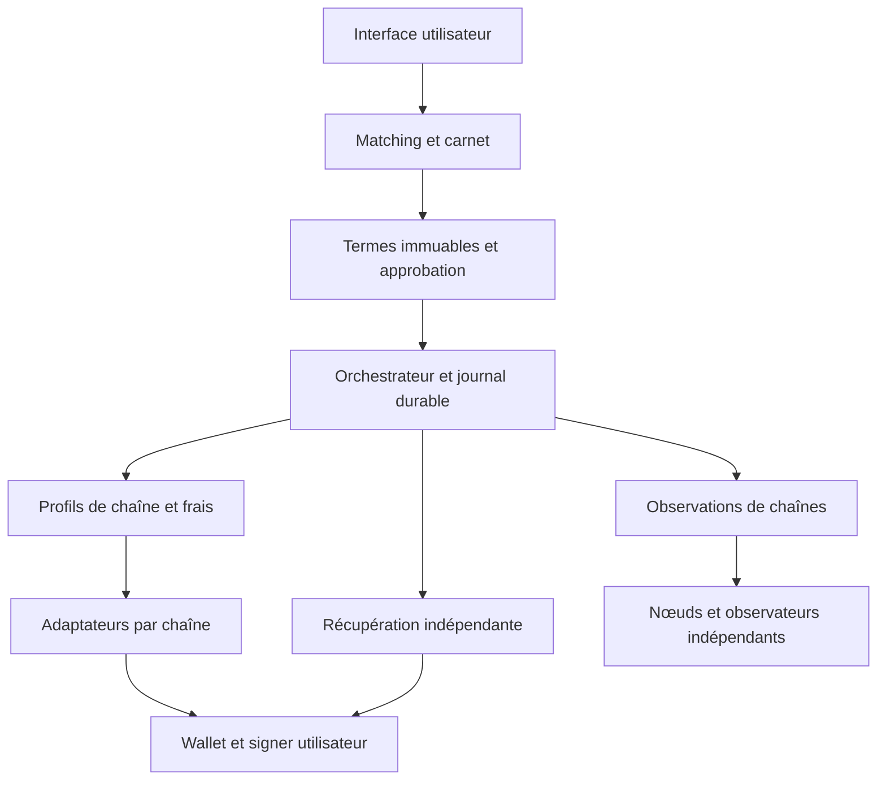

# Lot B — architecture candidate et limites de confiance

Décision proposée : **C, hybride modulaire, avec un noyau GPUbnb minimal (D)**.
Adopter des interfaces et des contre-tests issus de DCRDEX pour les UTXO ;
conserver BasicSwap/COMIT comme références d'un module XMR séparément audité.
Aucun moteur tiers, code cryptographique ou wallet n'est importé/activé ici.
La décision reste à approuver après revue de licence, maintenance et sécurité.

| Critère | A : composants DCRDEX | B : composants BasicSwap | C : hybride borné | D : tout spécifique |
| --- | --- | --- | --- | --- |
| Crypto/UTXO | Implémentations et tests utiles ; vérifier clone par clone | OtVES + branches par actif ; dépendances natives | Réutiliser bibliothèques auditées derrière contrats explicites | Réécrire la cryptographie accroîtrait fortement le risque |
| Cinq actifs | XMR trading absent/partiel | Cinq wallets ≠ dix paires ; DOGE–XMR rejeté | Gaps explicitement bloqués, pas masqués par routage | Toutes les preuves restent à produire |
| Refund | HTLC/CLTV et audit de script ; malleabilité à traiter | Recovery préparé, issues tardives et clés partagées à auditer | Une preuve de récupération propre à chaque profil | Long développement et audit indépendant requis |
| Intégration GPUbnb | Go/JSON et lifecycle wallet à isoler | Python, messaging, démons et état applicatif importants | Frontières de processus, schémas versionnés | Bon contrôle des interfaces, forte charge de maintenance |
| Licence | Blue Oak + transitives | MIT au dépôt ; licence des forks natifs à vérifier | BOM d'import minimal et notices par composant | N'élimine pas les licences des primitives nécessaires |
| Infra/coût | Un ou plusieurs nœuds/watchers par chaîne | Plusieurs wallets/nœuds + transport distribué | Coût mesuré par profil ; réplication watchers volontaire | Charge d'exploitation et de développement maximale |
| Temps | Plus court pour comparaison UTXO, pas pour qualification totale | Plus court pour étude XMR, pas pour preuve de sûreté | Phases indépendantes ; pas de calendrier garanti | Le plus long, surtout si primitives nouvelles |
| Audit/dépendance | Dépendance au modèle DEX et au suivi Go | Dépendance au protocole et aux forks crypto | Versions épinglées, adaptateur remplaçable, preuves locales | Audit complet à financer ; maintenance sans filet tiers |
| Signers futurs | Adapter les wallets actuels à des signers bornés | Wallets locaux puissants ; abstraction à restreindre | Interface de demande d'approbation exacte, séparée du backend | Responsabilité intégrale d'implémentation |

Le choix ne promet pas de couvrir immédiatement DOGE–XMR. Aucun fournisseur
examiné ne fournit à lui seul une preuve de cette paire directe répondant à
toutes les contraintes GPUbnb. Ne pas inventer une variante cryptographique
pour fermer cette case de la matrice.

Le diagramme décrit une conception. Aucune flèche ne représente un service
déployé ou une permission de diffuser. GPUbnb Core/location garde ses bases,
comptes de service, secrets, files et accès réseau distincts. Le backend
exchange ne reçoit ni seed, ni clé de dépense, ni wallet déverrouillé.

| Limite/interface proposée | Entrée et sortie | Responsabilité / interdit |
| --- | --- | --- |
| Matching | offre signée et réservations logiques → proposition de match | Aucun lock on-chain ni contrôle de clé ; arbitrage accept/cancel atomique en base |
| TermsValidator | termes canoniques + profil épinglé → digest et erreurs | Lie actif/réseau/genesis, montants entiers, rôles, scripts, fees et expirations |
| ChainObserver | référence attendue → preuve de bloc/spend fraîche et contradicteurs | Ne signe pas ; observations RPC non fiables jusqu'à validation du profil |
| TxPlanner | termes approuvés + UTXO attestés → plan sans signature + engagements | Pas de broadcast ; aucune conversion implicite d'unité ou substitution d'adresse |
| UserSigner | plan canonique + consentement local → octets signés ou refus | Externe au serveur ; compare les octets réellement signés au plan ; aucun autorisation actuelle de l'appeler |
| RecoveryExporter | termes + templates + données strictement nécessaires → export local versionné, hash public optionnel | Matériel secret chiffré chez l'utilisateur ; validation de restauration indépendante |
| EventStore/Outbox | événement attesté + version attendue → append atomique et intention unique | CAS, unicité idempotency key ; crash/replay ne crée pas un second spend |
| FeePolicy | montant, unité et taille/poids taggés → plafond/réserve ou rejet | Commission séparée ; aucun frais arbitraire d'annulation |
| Audit | IDs/digests/états → preuve minimale sans secrets | Pas de preimage avant révélation publique, de clés ou de données KYC dans les logs |

Les adaptateurs ne doivent pas hériter des capacités à partir d'un symbole ou
d'une superclasse. BTC, DOGE, LTC transparent, BCH et XMR ont des profils de
consensus, des serializers et des politiques de signature distincts. Le booléen
has_segwit interne d'une librairie n'est pas une preuve de capacité de chaîne.

Persistance : traiter observations, intentions et effets réseau comme des objets
séparés. L'intention et la preuve de récupération doivent être durables avant
qu'un futur executor autorisé puisse agir. Après crash, rechercher l'effet par
engagement/txid attendu avant toute nouvelle tentative. Une incertitude ou un
effet conflictuel n'est jamais un accusé de succès. Prévoir journal append-only,
version de schéma, epoch de politique et export utilisateur restaurable.

Déploiement futur : un processus non privilégié par adaptateur et par réseau ;
allowlist RPC par méthode/paramètres ; quotas ; secrets utilisateur hors backend ;
egress minimal ; deux sources dont l'indépendance est réellement examinée.
Deux RPC pointant vers le même opérateur ne donnent pas deux preuves
indépendantes. Observer une transaction avec plusieurs sources ne supprime pas
les risques de consensus, censure ou reorg profonde.

Aucun coût de production ni délai de réalisation chiffré n'est prétendu sans
mesure de stockage, rescan, trafic, disponibilité signer et fenêtres de reprise.
Les bibliothèques Go/Rust/C natives nécessitent un BOM transitive, provenance,
patch cadence et tests ABI avant d'être intégrées. Un fork de sécurité doit
rester explicite ; KDF archivé n'est pas une dépendance de sécurité retenue.

La baseline DOGE de la préparation BasicSwap examinée est un fork tecnovert
23.2.1, non notre release officielle v1.14.9. DCRDEX constitue donc le point de
comparaison UTXO le plus directement aligné à étudier pour ce nœud. Même lui
reste à tester sur le profil exact. Aucun fork ou remplacement de confiance
D0 n'est inclus dans le choix hybride.
